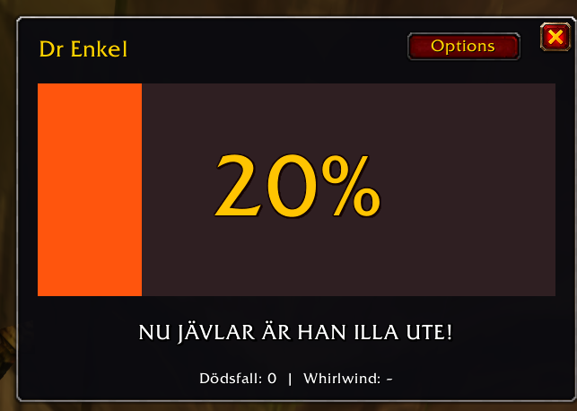
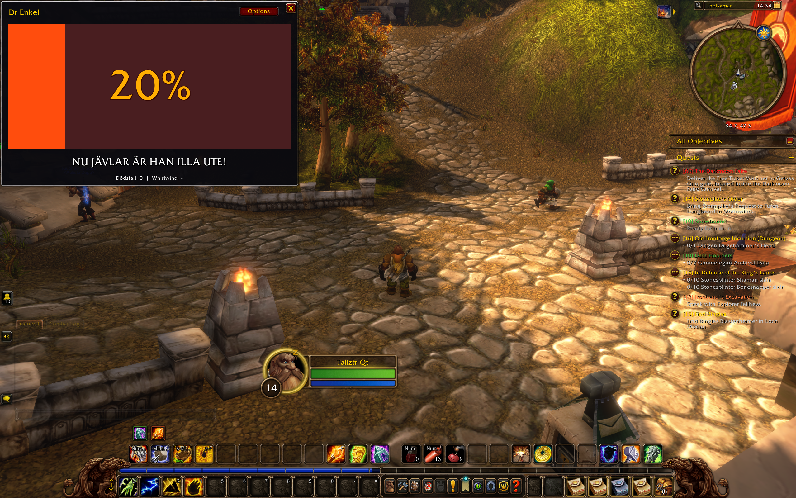
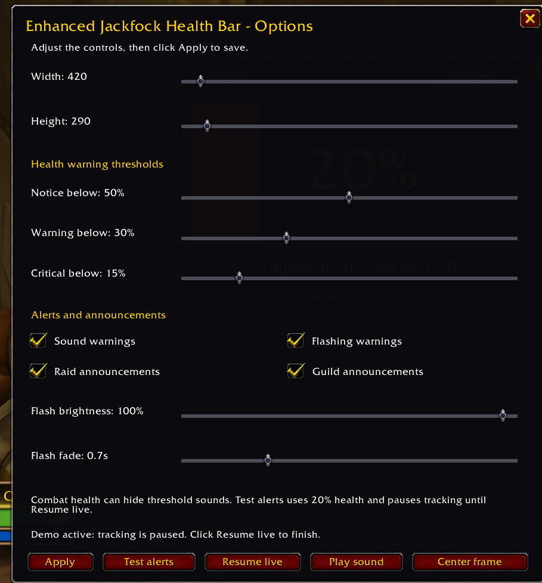

# Enhanced Jackfock Health Bar


A customizable health bar for Dr Enkel in **World of Warcraft: Forever**, with
warning lights, sounds and a few well-earned death announcements.

**[Download the latest release](https://github.com/dala23/Enhanced-Jackfock-Health-Bar/releases/latest)**

## Features

- Finds Dr Enkel automatically in your party or raid.
- Adjustable frame size, from compact to ridiculously large.
- Three health thresholds with yellow, orange and red warnings.
- Optional flashing, with adjustable brightness and fade speed.
- Swedish health commentary, from “Ser bra ut, kör Whirlwind” to
  “NU JÄVLAR ÄR HAN ILLA UTE!”.
- A saved death counter and a Whirlwind counter from Dr Enkel's own addon.
- Sound warnings, a sound preview and a local alert demo.
- Optional raid and guild death reports with a rotating roast, observed combat
  time and the killing blow when the native death recap provides it.
- Saved size, position and preferences. No extra addon libraries required.

## Screenshots

The health bar at 20%, with the warning commentary and counters:



A larger frame in the game world:



Frame size, warning thresholds, flashing and announcement controls:



## Install

1. Download the **EnhancedJackfockHealthBar-0.5.0.zip** asset from the release page.
   Use the addon ZIP rather than GitHub's automatically generated source archive.
2. Close WoW Forever and extract the ZIP.
3. Copy the **EnhancedJackfockHealthBar** folder into your Forever client's
   `Interface\AddOns` directory. The usual Windows location is:

   ```text
   C:\Program Files (x86)\World of Warcraft\_forever_\Interface\AddOns
   ```

   The manifest must end up at:

   ```text
   _forever_\Interface\AddOns\EnhancedJackfockHealthBar\EnhancedJackfockHealthBar.toc
   ```

4. Launch Forever. At character selection, open **AddOns** and enable
   **Enhanced Jackfock Health Bar**.
5. Log in and join Dr Enkel's party or raid. The health window opens automatically.

Keep the installed folder named **EnhancedJackfockHealthBar**. The name shown in WoW is
**Enhanced Jackfock Health Bar**. To update, replace that folder with the new
release and restart the client. Your saved preferences are kept separately by WoW.

## Set it up

Click **Options** at the top of the health window, or enter:

```text
/myforeveraddon options
```

Use the controls to change the width, height, warning thresholds, sound,
flashing, flash brightness, fade time and the sound filename. Raid and guild announcement switches
are there too. Click **Apply** to save. Closing without applying discards edits.

- **Test alerts** saves the controls and previews 20% health locally. Tracking and
  announcements pause during the demo. Click **Resume live** when finished.
- **Play sound** previews the filename currently typed in the form without saving it.
- **Stop sound** stops playback and silences automatic alarms until readable HP
  rises above 50% again.
- **Center frame** brings the health window back to the middle of the screen.

The comment follows his health: above 80% shows **Ser bra ut, kör Whirlwind**;
25-80% shows **Koordinera healingteamet**; below 25% shows
**NU JÄVLAR ÄR HAN ILLA UTE!**.

Dr Enkel should install the addon too. His client counts successful Whirlwind
casts and shares the total when the server permits addon messages. Until a
count arrives, other clients show `–`. His own count updates
locally. Counters are saved per watched character and count only observed events.
`*` marks the last count received from his addon; it can lag while sharing is
blocked. Whirlwind lookup currently uses its English spell name.

Drag the health window to move it. Enter `/myforeveraddon` to hide or show it.
The starting size is **420 x 290** UI units. Your saved size is kept when updating.
Width ranges from 360 to 4000; height ranges from 220 to 2000.
The default warning thresholds are **50%, 30% and 15%**. They must remain in
that order, from highest to lowest.

If Dr Enkel is in the raid but the addon cannot find him, target him and enter:

```text
/myforeveraddon watch
```

This captures his exact Forever character name. You can also use
`/myforeveraddon name Dr Enkel`. Enter `/myforeveraddon help` for all commands.

## Alarm sound

The emergency alarm is included as `Media/alarm.mp3`. With **Sound warnings**
enabled, it repeats while readable HP is between 0% and 50%. It stops without
fading on the next health update above 50%, at death, or when health is unavailable.

**Fully close and restart Forever after installing this version.** New sound
filenames may not be discovered by `/reload` alone.

To use another sound:

1. Put an `.mp3` or `.ogg` file in
   `Interface\AddOns\EnhancedJackfockHealthBar\Media`.
2. Restart Forever, open **Options**, and type only its filename under **Sound file**.
3. Click **Play sound** to test, then **Apply** to save. An empty filename uses
   WoW's built-in raid-warning sound.

Custom files use the **Master** audio channel. If a preview is silent, check
WoW's master audio/volume and the filename. A successful playback request does
not prove that the client decoded the file or that your speakers are audible.

**Test alerts** uses 20% demo health and starts the alarm. **Resume live** stops
it and resumes real tracking. Demo mode sends no raid or guild announcements.

## Death announcements and game limits

Raid and guild announcements are enabled by default. Only channels you belong
to are used. If several people install the addon, enable announcements on just
one installation to avoid duplicate reports.

Forever restricts some combat data and messaging:

- The health bar, colors and flashing use native display APIs. The alarm uses
  readable health only. It stops if HP becomes hidden, so automatic alarm
  behavior cannot be guaranteed during combat. Manual sound previews are separate.
- Reports wait until combat and chat messaging restrictions clear. They may be
  delayed, or expire after ten minutes if messaging stays blocked.
- Combat time is observed locally and approximate. A **+** means tracking started
  mid-fight, so the actual duration was longer. Reloading loses earlier timing.
- The killer is shown only when a fresh native death recap can be matched safely.
  Missing data, hidden casters or a changed meter session can leave it unavailable.
- Another player's weapon-swing count, ready defensive cooldowns and potion
  inventory cannot be read by this version. Reports mark those facts unavailable.

Supports **Forever**, targeting interface **16001**. Retail and Classic are not
supported. [Compatibility details and sources](docs/COMPATIBILITY.md).

## Troubleshooting

If the addon does not appear, check the folder structure above and restart
Forever. If the health window is hidden, enter `/myforeveraddon`.

For Lua errors, enter these commands one at a time:

```text
/console scriptErrors 1
/reload
```

Report the first error, your client version from `/run print(GetBuildInfo())`,
and what you were doing on the [issue tracker](https://github.com/dala23/Enhanced-Jackfock-Health-Bar/issues).
Disable error popups later with `/console scriptErrors 0`.

[Development and local checks](https://github.com/dala23/Enhanced-Jackfock-Health-Bar/blob/main/docs/DEVELOPMENT.md).
